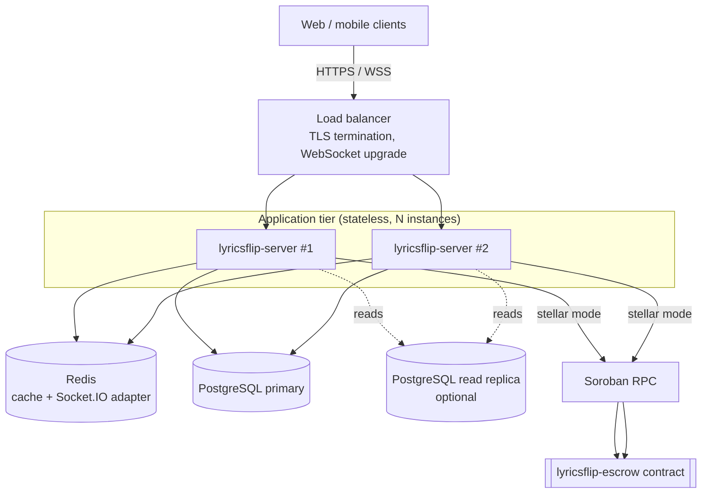

# Deployment runbook

This is the operator's guide to running the LyricsFlip server in production. It covers the topology, the environment each mode needs, how migrations are applied during a rollout, load balancer and Socket.IO settings, probes, scaling, backups, rollback, and what to do when a wager gets stuck.

If you only want to run the server locally, see [Getting started](../README.md#getting-started) in the README instead.

---

## Contents

- [Topology](#topology)
- [Environment per mode](#environment-per-mode)
- [Migrations on deploy](#migrations-on-deploy)
- [Load balancer timeouts and keep-alive](#load-balancer-timeouts-and-keep-alive)
- [Socket.IO and sticky sessions](#socketio-and-sticky-sessions)
- [Probes](#probes)
- [Scaling notes](#scaling-notes)
- [Backups](#backups)
- [Rollback](#rollback)
- [Incident checklist: a stuck wager](#incident-checklist-a-stuck-wager)
- [Two-instance staging walkthrough](#two-instance-staging-walkthrough)

---

## Topology

- **Application tier** — the NestJS server. Instances are stateless: no local disk state, no in-process session store. You can run one instance or many.
- **Redis** — shared cache and the Socket.IO adapter so events reach clients connected to any instance. Required as soon as you run more than one instance.
- **PostgreSQL** — the source of truth. A read replica is optional; when configured, reads are split off the primary.
- **Soroban RPC + escrow contract** — only in `stellar` settlement mode. The server never holds player funds; the contract does.

---

## Environment per mode

There are two settlement modes, chosen with `SETTLEMENT_MODE`:

- `mock` — balances are rows in Postgres. Good for development and staging.
- `stellar` — stakes are real tokens held by the Soroban escrow contract. Only for production with real value.

### Required in every mode

| Variable | Notes |
| --- | --- |
| `NODE_ENV` | `production` in production. |
| `PORT` | Port the server listens on (default `3000`). |
| `DATABASE_URL` | PostgreSQL connection string. |
| `JWT_SECRET` | Long random secret. Rotating it invalidates every issued token. |
| `JWT_EXPIRES_IN` | Token lifetime, e.g. `1h`. |
| `SETTLEMENT_MODE` | `mock` or `stellar`. |

### Recommended in every mode

| Variable | Notes |
| --- | --- |
| `REDIS_URL` | Required for more than one instance (cache + Socket.IO adapter). |
| `HTTP_KEEP_ALIVE_TIMEOUT_MS` | Must be **shorter** than the load balancer idle timeout. See [below](#load-balancer-timeouts-and-keep-alive). |
| `CORS_ORIGIN` | Comma-separated list of allowed browser origins. |
| `LOG_LEVEL` | `info` in production; `debug` only while diagnosing. |
| `DATABASE_REPLICA_URL` | Optional read replica. |

### Additional variables in `stellar` mode

| Variable | Notes |
| --- | --- |
| `SOROBAN_RPC_URL` | Soroban RPC endpoint. |
| `SOROBAN_NETWORK_PASSPHRASE` | Network passphrase (public or testnet). |
| `ESCROW_CONTRACT_ID` | Deployed escrow contract address. |
| `TOKEN_CONTRACT_ID` | LYRIC token contract / SAC address. |
| `SERVER_STELLAR_SECRET` | Server signing key. **Treat as a secret.** |
| `SEP10_HOME_DOMAIN` | Domain used in SEP-10 challenges. |

### Stellar-mode checklist

Before you flip `SETTLEMENT_MODE` to `stellar` in an environment:

- [ ] `SOROBAN_RPC_URL` points at the network you intend (testnet vs. public) and `SOROBAN_NETWORK_PASSPHRASE` matches it.
- [ ] `ESCROW_CONTRACT_ID` and `TOKEN_CONTRACT_ID` are the audited deployments for that network.
- [ ] `SERVER_STELLAR_SECRET` is loaded from a secret manager, not baked into the image or committed.
- [ ] `SEP10_HOME_DOMAIN` matches the public hostname clients use.
- [ ] The server account is funded and can submit transactions (check the RPC health endpoint).
- [ ] Reconciliation has run at least once against the new contract (see [Reconciliation](../README.md#reconciliation)).
- [ ] You have a rollback plan back to `mock` that does not strand in-flight wagers.

---

## Migrations on deploy

Migrations are TypeORM migrations under `src/database/migrations`. They are **not** run automatically by the application at boot.

**Who runs them:** exactly one job per deploy, before the new application version starts serving traffic. Do not let every instance run migrations — concurrent runners race on the migrations table.

Recommended ordering for a rolling deploy:

1. **Run migrations once** as a dedicated step (a one-off job, a `pre-deploy` hook, or a single instance with `RUN_MIGRATIONS=true`). Wait for it to exit successfully.
2. **Roll out the new application version** to the instances.
3. **Verify** with the readiness probe and a smoke request.

Rules of thumb:

- Migrations must be **backwards compatible** with the version currently serving traffic, because during a rolling deploy old and new instances run side by side. Add columns as nullable, backfill, then tighten in a later release.
- Never run a destructive migration (drop/rename) in the same release that stops using the old shape.
- If a migration fails, **stop the rollout**. Do not start new instances against a half-migrated schema.

---

## Load balancer timeouts and keep-alive

The server keeps HTTP connections alive. If the load balancer's idle timeout is shorter than the server's keep-alive timeout, the balancer can close a connection at the same moment the server reuses it, and clients see sporadic `502`/`connection reset` errors.

Set `HTTP_KEEP_ALIVE_TIMEOUT_MS` **below** the load balancer idle timeout, with margin:

| Load balancer idle timeout | Suggested `HTTP_KEEP_ALIVE_TIMEOUT_MS` |
| --- | --- |
| 60 s | 55000 |
| 30 s | 25000 |
| 15 s | 10000 |

Also make sure the balancer's **request/response timeout** is longer than your slowest legitimate request (Soroban submission can take several seconds). A value around 30–60 s is typical.

---

## Socket.IO and sticky sessions

The realtime gateway is Socket.IO on the `/game` namespace.

- **With a single instance:** no sticky sessions needed.
- **With multiple instances:** configure the Socket.IO **Redis adapter** (via `REDIS_URL`) so events fan out across instances. With the adapter in place, **sticky sessions are not required** for correctness — any instance can serve any socket.
- If you cannot run the Redis adapter, you **must** enable sticky sessions at the load balancer (cookie- or IP-hash based) so a client's polling handshake and upgrades land on the same instance.

The load balancer must allow the **WebSocket upgrade** on the gateway path and must not buffer the connection.

---

## Probes

Expose two endpoints to the orchestrator / load balancer:

- **Liveness** — is the process alive? Should not touch the database or Redis. Restart the instance if it fails.
- **Readiness** — can this instance serve traffic? Checks the database connection (and Redis when configured). Remove the instance from the load balancer if it fails, but do not restart it.

During a rollout, wait for readiness before sending traffic to a new instance, and drain connections from an old instance before terminating it (see the keep-alive timeout above for the drain window).

---

## Scaling notes

- The application tier is stateless; scale it horizontally behind the load balancer.
- **Redis is required** for more than one instance (shared cache + Socket.IO adapter).
- The database is the bottleneck for writes. Watch connection-pool usage per instance; total connections across instances must stay under the Postgres limit.
- A read replica offloads read-heavy endpoints; point `DATABASE_REPLICA_URL` at it.
- Soroban RPC has rate limits. In `stellar` mode, scale the application tier with the RPC quota in mind, and keep reconciliation running on a schedule.

---

## Backups

- Take regular **PostgreSQL base backups plus WAL archiving** (or your managed provider's point-in-time recovery). Test a restore on a schedule — an untested backup is not a backup.
- Back up **before** running migrations on a release that changes schema.
- In `stellar` mode, the escrow contract is the source of truth for funds. The database records intent and history; keep it consistent with on-chain state via reconciliation. Back up the database, but never treat it as the authority over the contract.

---

## Rollback

1. **Application rollback** — redeploy the previous image. Because migrations are backwards compatible, the previous version keeps working against the migrated schema.
2. **Migration rollback** — only if the release shipped a reversible migration and you have confirmed the previous version tolerates the reverted schema. Prefer a forward fix over a down-migration in production.
3. **Stellar mode** — do not roll back the contract casually. If you must return to `mock`, first drain in-flight wagers (see the incident checklist) so no stake is left mid-handshake.

---

## Incident checklist: a stuck wager

A wager is "stuck" when it is not in a terminal state and no progress is being made (e.g. a handshake step never completed, or a settlement transaction is pending).

1. **Identify the wager.** Find the `GameSession` / wager record and its current state. Note the settlement mode.
2. **Check the chain (stellar mode).** Look up the escrow contract state and any pending transaction for that wager on Soroban RPC. Confirm whether funds are still in escrow, already released, or never deposited.
3. **Check reconciliation.** Run reconciliation and read its output — it compares database intent with on-chain state and reports mismatches.
4. **Do not hand-edit balances.** In `mock` mode, fix state through the application's own settlement path, not by editing rows directly. In `stellar` mode, never move funds outside the contract.
5. **Resolve.** If the handshake stalled before deposit, the wager can be cancelled. If funds are in escrow and the match is decided, drive settlement through the normal path. If the contract and database disagree, follow reconciliation's guidance and record what you did.
6. **Communicate and follow up.** Note the wager id, timeline, and resolution in the incident, and file a bug if the stall was caused by the server.

---

## Two-instance staging walkthrough

This is the minimum to stand up a two-instance staging environment.

1. **Provision** a PostgreSQL database, a Redis instance, and two application hosts (or two replicas of the same image).
2. **Configure** each instance with the required variables from [Environment per mode](#environment-per-mode), using `SETTLEMENT_MODE=mock` for staging, plus `REDIS_URL` and `HTTP_KEEP_ALIVE_TIMEOUT_MS` set below the load balancer idle timeout.
3. **Run migrations once** as a one-off job against the staging database and wait for it to finish.
4. **Start both instances** and confirm each passes its readiness probe.
5. **Put a load balancer** in front of both, terminating TLS, allowing the WebSocket upgrade, and with an idle timeout above `HTTP_KEEP_ALIVE_TIMEOUT_MS`.
6. **Smoke test:** sign up, log in, request a lyric, and open a Socket.IO connection to `/game` — confirm events arrive regardless of which instance the client lands on (this proves the Redis adapter is wired).
7. **Scale check:** stop one instance and confirm the other keeps serving and realtime events still flow.

Once staging is green, repeat the same steps for production, switching `SETTLEMENT_MODE` to `stellar` only after the [stellar-mode checklist](#stellar-mode-checklist) passes.
