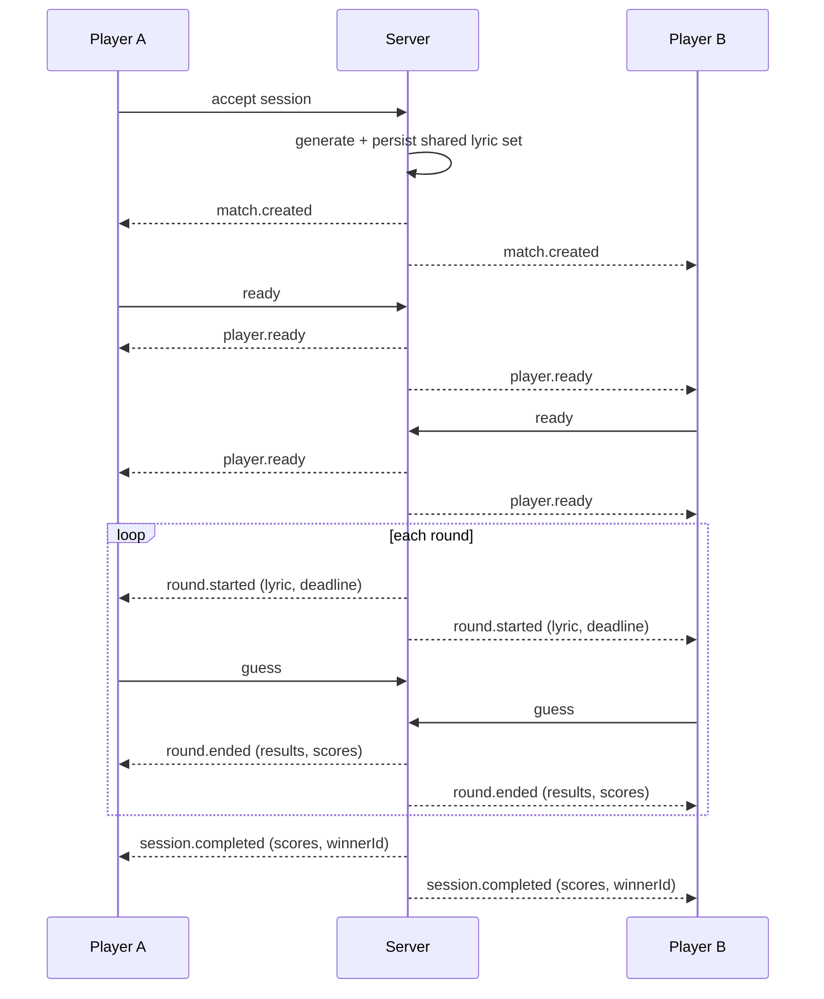

# Realtime Protocol

This document describes the realtime WebSocket protocol served under the `/realtime` namespace. It covers the head-to-head match flow introduced for issue #335: shared lyric sets, ready handshakes, synchronised rounds, live scores, disconnects, timeouts, and restart recovery.

> **Generated file.** The event tables below are generated from the typed event maps in `src/realtime/realtime.events.ts` (`ServerToClientEvents` / `ClientToServerEvents`) by `scripts/generate-realtime-docs.ts`. Do not edit the tables by hand — update the typed maps and regenerate.

## Protocol version

The current protocol version is `1`. The `connected` event carries a `protocolVersion` field so clients can detect incompatible servers before sending any message.

## Connection

Clients connect to the `/realtime` namespace and authenticate with their session token. After authentication the server associates the socket with the player's `userId` and any active `sessionId`, then emits `connected` with `{ userId, sessionId, protocolVersion }`.

## Match lifecycle

A head-to-head match is created when a head-to-head session is accepted. The server then drives the match through a fixed sequence of events so that both clients observe the same state.

### Events (server → client)

| Event | Payload | Description |
| --- | --- | --- |
| `connected` | `{ userId, sessionId, protocolVersion }` | Sent after authentication. `protocolVersion` identifies the realtime contract version. |
| `match.created` | `{ sessionId, players, totalRounds }` | Emitted on accept. A shared ordered lyric set has been generated and persisted. |
| `player.ready` | `{ sessionId, userId }` | Broadcast when a player sends `ready`. |
| `round.started` | `{ sessionId, round, lyric, deadline }` | Sent to both players with the same lyric and the same absolute `deadline` (ISO timestamp). |
| `round.ended` | `{ sessionId, round, results }` | Sent to both players with each player's guess outcome and updated scores. |
| `session.completed` | `{ sessionId, scores, winnerId }` | Emitted after the last round. Triggers wager settlement (see issue 40). |
| `opponent.disconnected` | `{ sessionId, userId, graceDeadline }` | The opponent dropped; a grace period is running. |
| `opponent.reconnected` | `{ sessionId, userId }` | The opponent reconnected within the grace period. |
| `match.forfeited` | `{ sessionId, userId, reason }` | A player forfeited (disconnect grace expired or round timeout). |
| `match.aborted` | `{ sessionId, reason }` | The match was cleanly aborted (e.g. server restart could not resume). Wagers are refunded. |
| `newLyric` | `GameRoundResponse` | `/game` gateway: a new round was issued (mirrors `GET /game/lyric`). |
| `guessResult` | `GuessResultResponse` | `/game` gateway: result of a submitted guess (mirrors `POST /game/guess`). |
| `hintResult` | `HintResponse` | `/game` gateway: result of a hint request (mirrors `GET /game/round/:id/hint`). |
| `sessionInfo` | `{ sessionId, userId, protocolVersion }` | `/game` gateway: session context for the connected socket. |
| `error` | `{ code, message, details? }` | Shared error contract (see below). |

### Events (client → server)

| Event | Payload | Description |
| --- | --- | --- |
| `ready` | `{ sessionId }` | Player signals readiness. The first round starts once both players are ready. |
| `guess` | `{ sessionId, round, guess }` | Submit a guess for the current round. |
| `reconnect` | `{ sessionId }` | Re-attach to an in-progress match after a disconnect. |
| `requestLyric` | `{ sessionId? }` | `/game` gateway: request a new round (mirrors `GET /game/lyric`). |
| `submitGuess` | `{ roundId, guess }` | `/game` gateway: submit a guess (mirrors `POST /game/guess`). |
| `requestHint` | `{ roundId }` | `/game` gateway: request a hint (mirrors `GET /game/round/:id/hint`). |

## Error contract

All errors emitted over the socket share a single shape:

```json
{
  "event": "error",
  "data": {
    "code": 400,
    "message": "Validation failed",
    "details": [
      { "field": "guess", "message": "guess must be a string" }
    ]
  }
}
```

- `code` — numeric status code (HTTP-style, e.g. `400`, `403`, `500`).
- `message` — human-readable summary.
- `details` — optional array of field-level messages (present for validation
  failures).

## Round flow

1. On accept, the server generates a shared ordered lyric set and persists it with the session.
2. Each player emits `ready`. When both are ready, the server starts round 1.
3. For each round the server emits `round.started` to both players with the same lyric and the same `deadline`.
4. Guesses are collected until both players have guessed or the deadline passes.
5. The server emits `round.ended` with both results and updated scores.
6. Steps 3–5 repeat for each lyric in the set.
7. After the last round the server emits `session.completed`.

## Disconnects and timeouts

- **Disconnect:** when a player disconnects mid-match, the server emits `opponent.disconnected` and starts a grace period. If the player reconnects and emits `reconnect` before the grace period expires, the server emits `opponent.reconnected` and the match continues. If the grace period expires, the server emits `match.forfeited` and completes the session in favour of the remaining player.
- **Round timeout:** if a player does not guess before the round `deadline`, the round ends with that player's guess treated as a miss. A player who misses every round deadline forfeits.

## Restart recovery

Match state (shared lyric set, current round, per-round results, scores, ready flags, and deadlines) is persisted so that a server restart mid-match can either resume the match from the last completed round or cleanly abort it. On abort the server emits `match.aborted` and refunds any wagers associated with the session.

## `/game` gateway messages (client → server)

The `/game` namespace runs the same round loop as the HTTP API: every message is backed by `GameLogicService`, so a round row, its answer window, speed bonus, hints and history are created identically whether you play over WebSocket or HTTP. Socket-local state is keyed by `client.id`, so two tabs of the same user play independently and disconnecting one tab does not affect the other. Authoritative state lives in the database.

Each socket message maps to exactly one HTTP endpoint and returns **the same response shape** as that endpoint — the same fields, the same values, the same `expiresAt`, hints, XP and history. A client can switch between HTTP and WebSocket mid-round without changing how it parses responses.

| Message        | Payload              | Mirrors HTTP endpoint            | Ack (identical to the HTTP response) |
| -------------- | -------------------- | -------------------------------- | ------------------------------------ |
| `requestLyric` | `{ sessionId? }`     | `GET /game/lyric`                | `GameRoundResponse`                  |
| `submitGuess`  | `{ roundId, guess }` | `POST /game/guess`               | `GuessResultResponse`                |
| `requestHint`  | `{ roundId }`        | `GET /game/round/:id/hint`       | `HintResponse`                       |

### `requestLyric` → `GET /game/lyric`

Picks a lyric and issues a round in one step (`GameLogicService.startRound`), exactly as the HTTP controller does. The ack is the HTTP `GameRoundResponse`:

```json
{
  "id": "b1e2c3d4-...",
  "lyricId": "9f8e7d6c-...",
  "issuedAt": "2024-05-01T12:00:00.000Z",
  "expiresAt": "2024-05-01T12:00:30.000Z",
  "answerWindowSeconds": 30,
  "lyric": {
    "id": "9f8e7d6c-...",
    "text": "…",
    "artist": "…",
    "title": "…"
  }
}
```

`expiresAt` is the same absolute deadline the HTTP response returns; the answer window, hard expiry and anti-replay checks are enforced server-side. When the pool is exhausted the ack carries the standard error contract (`404`, `NotFoundException`).

### `submitGuess` → `POST /game/guess`

The ack is the HTTP `GuessResultResponse`, with the same scoring, speed bonus, XP award and history row:

```json
{
  "roundId": "b1e2c3d4-...",
  "isCorrect": true,
  "points": 120,
  "speedBonus": 20,
  "timedOut": false,
  "hintsUsed": 1,
  "xp": 15,
  "history": { "id": "…", "createdAt": "2024-05-01T12:00:12.000Z" }
}
```

### `requestHint` → `GET /game/round/:id/hint`

The ack is the HTTP `HintResponse`, with the same hint text, hint count and points penalty:

```json
{
  "roundId": "b1e2c3d4-...",
  "hint": "…",
  "hintsUsed": 1,
  "pointsPenalty": 10
}
```

`submitGuess` and `requestHint` persist a round and a history row, so every WebSocket guess is scored and recorded exactly like an HTTP one (R3-70).

## Where events come from


