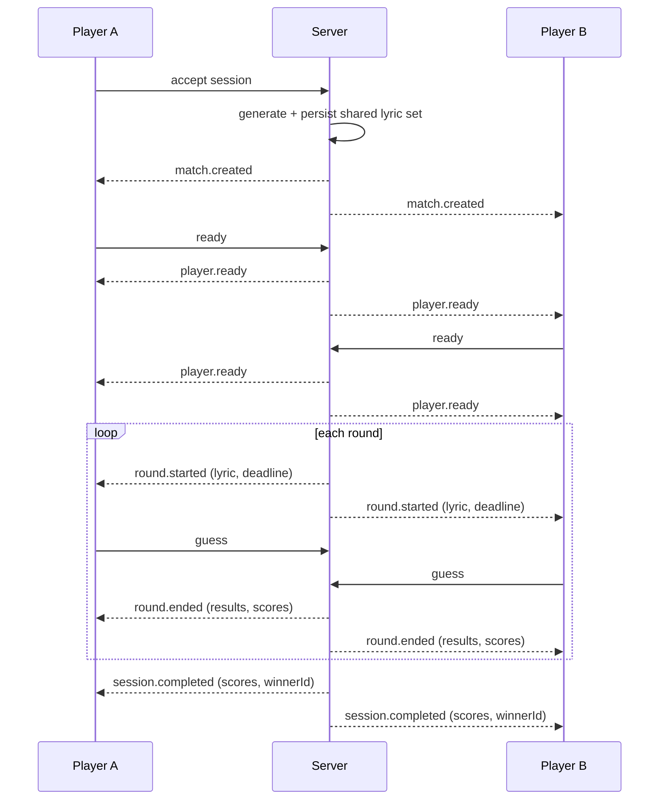
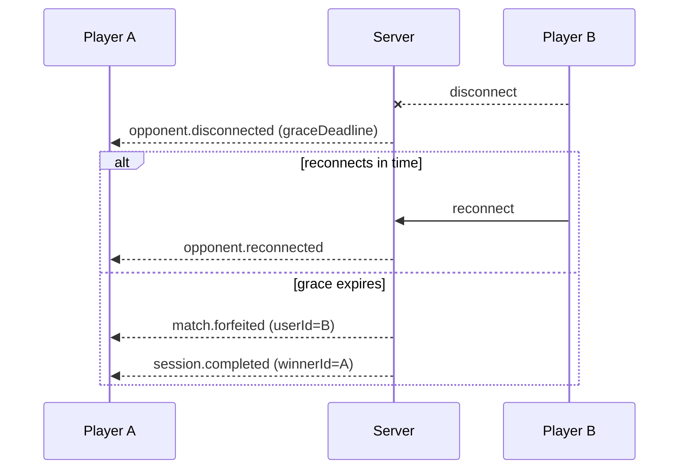

# Realtime Protocol

This document describes the realtime WebSocket protocol served under the `/realtime` namespace. It covers the head-to-head match flow introduced for issue #335: shared lyric sets, ready handshakes, synchronised rounds, live scores, disconnects, timeouts, and restart recovery.

## Connection

Clients connect to the `/realtime` namespace and authenticate with their session token. After authentication the server associates the socket with the player's `userId` and any active `sessionId`.

## Match lifecycle

A head-to-head match is created when a head-to-head session is accepted. The server then drives the match through a fixed sequence of events so that both clients observe the same state.

### Events (server → client)

| Event | Payload | Description |
| --- | --- | --- |
| `match.created` | `{ sessionId, players, totalRounds }` | Emitted on accept. A shared ordered lyric set has been generated and persisted. |
| `player.ready` | `{ sessionId, userId }` | Broadcast when a player sends `ready`. |
| `round.started` | `{ sessionId, round, lyric, deadline }` | Sent to both players with the same lyric and the same absolute `deadline` (ISO timestamp). |
| `round.ended` | `{ sessionId, round, results }` | Sent to both players with each player's guess outcome and updated scores. |
| `session.completed` | `{ sessionId, scores, winnerId }` | Emitted after the last round. Triggers wager settlement (see issue 40). |
| `opponent.disconnected` | `{ sessionId, userId, graceDeadline }` | The opponent dropped; a grace period is running. |
| `opponent.reconnected` | `{ sessionId, userId }` | The opponent reconnected within the grace period. |
| `match.forfeited` | `{ sessionId, userId, reason }` | A player forfeited (disconnect grace expired or round timeout). |
| `match.aborted` | `{ sessionId, reason }` | The match was cleanly aborted (e.g. server restart could not resume). Wagers are refunded. |

### Events (client → server)
# Realtime (WebSocket) API

This document describes the WebSocket error contract used by the game and
realtime gateways.

## Error contract

All errors emitted over the socket share a single shape:

```json
{
  "event": "error",
  "data": {
    "code": 400,
    "message": "Validation failed",
    "details": [
      { "field": "guess", "message": "guess must be a string" }
    ]
  }
}
```

- `code` — numeric status code (HTTP-style, e.g. `400`, `403`, `500`).
- `message` — human-readable summary.
- `details` — optional array of field-level messages (present for validation
  failures).
## Rooms

| Event | Payload | Description |
| --- | --- | --- |
| `ready` | `{ sessionId }` | Player signals readiness. The first round starts once both players are ready. |
| `guess` | `{ sessionId, round, guess }` | Submit a guess for the current round. |
| `reconnect` | `{ sessionId }` | Re-attach to an in-progress match after a disconnect. |

## Round flow

1. On accept, the server generates a shared ordered lyric set and persists it with the session.
2. Each player emits `ready`. When both are ready, the server starts round 1.
3. For each round the server emits `round.started` to both players with the same lyric and the same `deadline`.
4. Guesses are collected until both players have guessed or the deadline passes.
5. The server emits `round.ended` with both results and updated scores.
6. Steps 3–5 repeat for each lyric in the set.
7. After the last round the server emits `session.completed`.

## Disconnects and timeouts

- **Disconnect:** when a player disconnects mid-match, the server emits `opponent.disconnected` and starts a grace period. If the player reconnects and emits `reconnect` before the grace period expires, the server emits `opponent.reconnected` and the match continues. If the grace period expires, the server emits `match.forfeited` and completes the session in favour of the remaining player.
- **Round timeout:** if a player does not guess before the round `deadline`, the round ends with that player's guess treated as a miss. A player who misses every round deadline forfeits.

## Restart recovery

Match state (shared lyric set, current round, per-round results, scores, ready flags, and deadlines) is persisted so that a server restart mid-match can either resume the match from the last completed round or cleanly abort it. On abort the server emits `match.aborted` and refunds any wagers associated with the session.

## Sequence diagram
## `/game` gateway messages (client → server)

The `/game` namespace runs the same round loop as the HTTP API: every message is backed by `GameLogicService`, so a round row, its answer window, speed bonus, hints and history are created identically whether you play over WebSocket or HTTP. Socket-local state is keyed by `client.id`, so two tabs of the same user play independently and disconnecting one tab does not affect the other. Authoritative state lives in the database.

| Message        | Payload                                                       | Ack                                                                                                                              |
| -------------- | ------------------------------------------------------------- | -------------------------------------------------------------------------------------------------------------------------------- |
| `requestLyric` | `{ sessionId? }`                                              | `{ roundId, issuedAt, answerWindowSeconds, lyric }` — or `{ error }` when the pool is exhausted (`NotFoundException`)          |
| `submitGuess`  | `{ roundId, guess }`                                          | `{ roundId, isCorrect, points, speedBonus, timedOut, hintsUsed }` — same scoring as `POST /game/guess`                          |
| `requestHint`  | `{ roundId }`                                                 | `{ roundId, hint, hintsUsed, pointsPenalty }` — same as `POST /game/hint`                                                        |

`requestLyric` returns `roundId`, `issuedAt` and `answerWindowSeconds` so the client can render the countdown; the answer window, hard expiry and anti-replay checks are enforced server-side. `submitGuess` and `requestHint` persist a round and a history row, so every WebSocket guess is scored and recorded exactly like an HTTP one.

## Where events come from



### Disconnect / forfeit


### Ack callbacks

When a client sends an event with an acknowledgement callback, the same
`{ code, message, details }` object is passed to the ack instead of (or in
addition to) the `error` event, so callers can handle failures inline.

### Validation failures

Gateway handlers validate payloads with a `ValidationPipe` configured with an
exception factory that throws `WsException`. An invalid payload (for example an
invalid `submitGuess` body) therefore returns a `400`-style error with
field-level messages over the socket rather than a generic
`Internal server error`.

## Guards, interceptors, filters and `@GetUser` in gateways

The app's HTTP enhancers check the execution context type, so they can be
applied to a gateway with `@UseGuards`, `@UseInterceptors` and `@UseFilters`
(#362). Before, each called `switchToHttp()` and read `headers` from the
socket, so a handler failed with a `TypeError` that hid the real error.

| Enhancer | In a WebSocket handler |
| --- | --- |
| `JwtAuthGuard` | Passes when the socket has `client.data.user`, set when the gateway verified the handshake token; otherwise `401`. The token is not re-checked per message. |
| `RolesGuard` / `@Roles(...)` | Checks `client.data.user.role`. |
| `@GetUser()` | Returns `client.data.user`: `{ id, username, role }` from the token, not a full `User`. |
| `AppThrottlerGuard` | Limits messages per user (or handshake address). |
| `LoggingInterceptor` | Logs the event name and socket ID, and the real error message on failure. |
| `AllExceptionsFilter` | Logs the real error with the event and socket ID, then emits the error contract above. |
| `AuditInterceptor` | Records the socket user as the actor and the message body as the payload. |

Each passes other context types (scheduled jobs, RPC) straight through.
`GameGateway` and `RealtimeGateway` store `client.data.user` (and
`client.data.userId`) in `handleConnection`. A new gateway must do the same
before relying on these enhancers.
